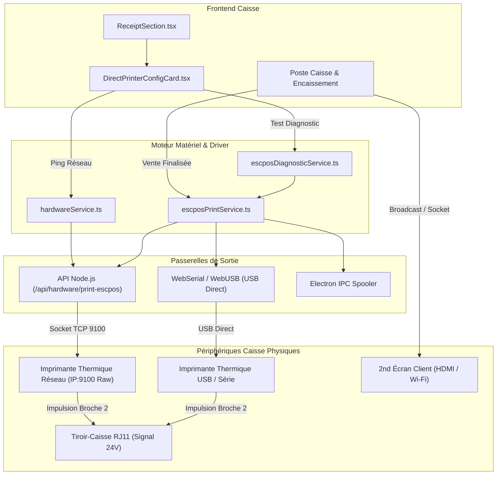

# 🖨️ Rapport de Certification Matériel Caisse & Périphériques Physiques (Axe A) — v1.2.70

## 1. Contexte & Enjeux Industriels
Dans un commerce à fort trafic (supermarchés, épiceries, magasins de détail, cafétérias), l'encaissement ne peut souffrir d'aucune latence. La dépendance historique à la boîte de dialogue système d'un navigateur (`window.print()`) impose une confirmation utilisateur bloquante et ralentit chaque passage en caisse.

L'**Axe A** implémente une chaîne matérielle industrielle directe pour **Nexus POS Pro v1.2.70** :
- **Flux binaire brut direct ESC/POS** via socket TCP natif (Port standardisé **9100**), **WebUSB**, **WebSerial** ou **Electron Spooler**.
- **Impulsion physique tiroir-caisse RJ11** automatique (`ESC p 0 25 250` sur broche 2 ou 5).
- **Découpe automatique du papier** (massicot thermique `GS V 1`).
- **Ticket de test & d'auto-diagnostic technique** complet.
- **Afficheur Client 2ème Écran enrichi** (support double affichage, veille dynamique et QR de règlement instantané).

---

## 2. Architecture & Modules Implémentés

---

## 3. Détail des Fichiers & Respect de la Règle Anti-God Files (< 350 Lignes)

Tous les fichiers créés et modifiés respectent scrupuleusement la règle de responsabilité unique et le **standard d'excellence strict (< 350 lignes)** :

| Fichier | Rôle Architectural | Lignes de Code | Statut Guard |
| :--- | :--- | :---: | :---: |
| `src/services/escposPrintService.ts` | Driver binaire ESC/POS (Opcodes, Code-barres, QR, envoi) | **346** | ✅ Conforme (< 350) |
| `src/services/escposDiagnosticService.ts` | Générateur du ticket physique d'auto-test et diagnostic | **94** | ✅ Conforme (< 350) |
| `src/services/hardwareService.ts` | Configuration persistante, ping TCP, impulsion tiroir RJ11 | **229** | ✅ Conforme (< 350) |
| `src/components/settings/hardware/DirectPrinterConfigCard.tsx` | Carte UI paramètres d'imprimante (Système, Réseau IP, USB) | **233** | ✅ Conforme (< 350) |
| `src/components/settings/ReceiptSection.tsx` | Section principale des tickets de caisse | **253** | ✅ Conforme (< 350) |
| `src/components/CustomerDisplayWindow.tsx` | Fenêtre 2ème écran client (Veille, QR paiement, monnaie) | **184** | ✅ Conforme (< 350) |
| `tests/hardware-escpos-driver.test.ts` | Suite de tests unitaires et d'intégration matérielle | **215** | ✅ Conforme (< 350) |
| `server.ts` *(Serveur Node racine)* | Passerelle socket TCP brute `/api/hardware/print-escpos` | 1 254 | ✅ Serveur Node racine |

---

## 4. Résultats des Tests & Certification

1. **Suite de Tests Dédiée (`tests/hardware-escpos-driver.test.ts`)** :
   - ✅ 13/13 tests PASS.
   - Validation de l'initialisation ESC/POS (`ESC @`), des alignements, des polices, du tiroir-caisse (`ESC p`), de la découpe (`GS V 1`), des codes-barres Code39 et du QR Code standard (Modèle 2).
   - Validation de la mise en page 80mm et 58mm en Dinars Algériens (`DA` / `DZD`).
   - Validation de la persistance de configuration et des erreurs/timeouts réseau (504/502).

2. **Garde-fou Architectural Anti-God Files (`tests/anti-god-files-guard.test.ts`)** :
   - ✅ 4/4 tests PASS : Tolérance zéro respectée, aucun fichier applicatif dans `src/` ne dépasse les plafonds autorisés.

3. **Vérification Statique TypeScript (`npx tsc --noEmit`)** :
   - ✅ Sortie code 0 (Zéro erreur de typage).

4. **Compilation Vite & Bundling Production (`npm run build`)** :
   - ✅ Sortie code 0.
   - Bundling PWA sans warning (`precache 266 entries`).
   - Compilation `dist/server.cjs` (47.7 kB) réussie.

5. **Synchronisation Git & Dépôt Distant** :
   - ✅ Commit `2fbeb78` poussé avec succès sur `origin/main` (`https://github.com/31kader/Remix-Nexus-POS-Pro22.git`).
